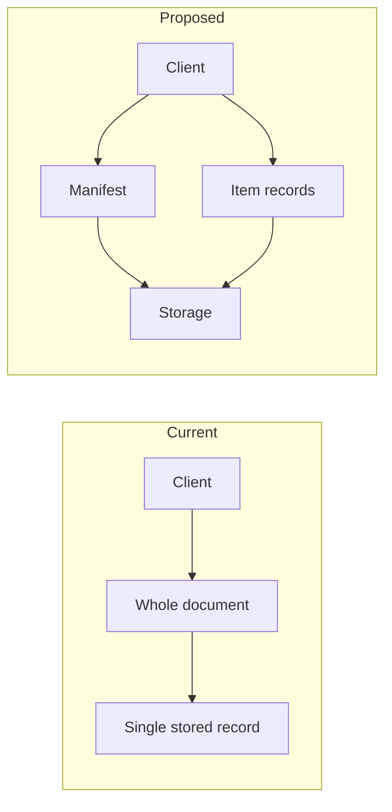

# To Spec

Synthesize the current conversation into a design specification and publish it to the project issue tracker. Do not restart discovery or interview the user about requirements already established.

The specification has two audiences:

- **Design** is the primary artifact. A human should understand the problem, proposed system, important behavior, and tradeoffs by scanning diagrams and short supporting text.
- **Agent appendix** is the execution artifact. It captures the exhaustive contracts, edge cases, acceptance criteria, and test guidance needed to implement the design.

The issue tracker and triage label vocabulary should have been provided. If they are missing, tell the user to run `/setup-matt-pocock-skills`.

## Process

1. Explore the repository enough to understand the current behavior and the affected domain. Use the project's domain vocabulary and respect relevant architectural decisions.

2. Identify the few questions the design must answer visually. Usually these are:

   - What exists now, and what changes?
   - Which concepts own or relate to which data?
   - What happens during the primary interaction?
   - How do lifecycle, failure, migration, or concurrency states resolve?

3. Sketch the highest practical test seam, preferring an existing seam. Check with the user that the seam matches their expectation. This is the only required confirmation; do not conduct a broader interview.

4. Draft the specification using the output contract below. Review it as a visual document before publishing: the design must remain understandable when the appendix is collapsed.

5. Publish the specification to the issue tracker using the publishing rules below, apply the `ready-for-agent` triage label, and return the issue link.

## Publishing Rules

The issue description is the canonical specification.

- When the conversation identifies an existing issue by number or URL, replace that issue's description with the revised specification. Update its title only when the approved design changes the issue's scope or makes the existing title inaccurate. Incorporate relevant decisions from its existing description and discussion into one coherent body.
- When no existing issue is identified, create a new issue.
- Apply corrections, review feedback, and later design revisions directly to the issue description. Do not append a comment containing a replacement section, correction, or newer version of the spec.
- Use comments only for discussion that should remain chronological and is not part of the specification itself.
- Preserve unrelated issue metadata such as assignees, milestones, and existing labels; add `ready-for-agent` when the specification passes the quality gate.

## Visual Language

Use Mermaid diagrams that render directly in GitHub Issues. Choose each diagram because it answers a distinct design question:

| Question | Preferred diagram |
| --- | --- |
| Current versus proposed structure | Side-by-side flowchart |
| Data ownership and relationships | Flowchart, ER, or class diagram |
| Request, event, or user interaction | Sequence diagram |
| Lifecycle, migration, retries, or failure | State diagram |
| User path through a feature | Journey or flowchart |

Use the smallest sufficient set, usually two to four diagrams. Complex designs may use more when each diagram carries a different idea. Keep each diagram focused, label nodes with domain language, and place a one-sentence takeaway immediately below it.

Diagrams are explanations, not decoration. Supporting prose should explain consequences and tradeoffs rather than narrating every arrow again. Prefer tables for comparisons and compact sets of related facts.

### GitHub-Native Components

The published issue is the complete design artifact. Build its visual hierarchy from constructs GitHub renders natively:

- Fenced `mermaid` blocks for structure, behavior, relationships, and state
- GitHub-flavored Markdown tables for decisions, comparisons, and matrices
- Task lists for short approval or completion checklists
- Blockquotes for a critical decision, risk, or invariant that must stand out
- A `
` block for the agent appendix

Use conservative Mermaid syntax supported by GitHub's current renderer. Avoid custom MDX components, renderer-specific directives, and experimental diagram types. Split dense diagrams by question; when a left-to-right diagram becomes wide, switch to top-to-bottom or divide it into smaller diagrams.

### Diagram Example

Use GitHub-compatible Mermaid syntax and keep labels concise. Adapt the structure to the actual domain rather than copying this example literally.

#### Current and Proposed Persistence

**Takeaway:** Independent item records reduce the scope of each update while the manifest preserves document-level configuration.

## Output Contract

The human-facing design comes first. Keep it concise and visually scannable. Put exhaustive execution detail only in the final appendix.

<spec-template>

## Outcome

In two or three sentences, state the user's problem, the proposed change, and the resulting benefit. Write from the user's perspective without using user-story syntax.

## Design

Open with the diagram that best communicates the overall current-to-proposed change. Add further diagrams for behavior, relationships, or lifecycle where they materially improve understanding.

For every diagram:

1. Give it a descriptive heading.
2. Render it as a Mermaid fenced block.
3. Follow it with a one-sentence **Takeaway:** that states why the diagram matters.

Use short prose between diagrams to connect ideas and call out behavior that is not visible in their structure.

## Key Decisions

Use a compact table:

| Decision | Choice | Why |
| --- | --- | --- |
| The decision being made | The selected design | The important consequence or tradeoff |

Include only decisions a reviewer may reasonably question or need to approve. Move mechanical implementation detail to the appendix.

## Scope

Use a compact table or short bullets to distinguish what this design delivers from what remains outside it.

## Agent Implementation Appendix

Contracts, edge cases, acceptance criteria, and test guidance

### Existing System

Record the relevant current behavior and constraints an implementation agent must preserve. Name source-of-truth contracts, architectural decisions, or modules when useful. Avoid general repository exposition.

### Implementation Requirements

Capture the complete implementation contract, grouped by responsibility rather than as user stories. Include, where relevant:

- Modules or boundaries that change
- Data ownership and identity rules
- Schema and API contracts
- Ordering, concurrency, retry, and idempotency behavior
- Migration and compatibility behavior backed by persisted data or shipped contracts
- Error handling and user-visible failure behavior
- Observability or operational requirements
- Documentation that must remain synchronized

Use precise tables, invariants, and pseudocode when they communicate the contract better than prose. Include file paths only when they identify an established source of truth or a concrete integration point. Do not include speculative code organization.

### Acceptance Matrix

Express externally observable behavior as a table rather than a long list of persona statements:

| Scenario | Expected result |
| --- | --- |
| A concrete input, action, conflict, or failure | The observable outcome |

The matrix must cover the happy path, meaningful boundaries, failures, migration or compatibility obligations, and concurrency behavior where applicable.

### Testing

State the agreed primary test seam and why it is the highest practical seam. Identify existing prior art and any narrower tests required for behavior that cannot be observed there. Tests should assert external behavior and durable invariants rather than helper implementation.

### Open Questions

List only unresolved decisions. If there are none, write `None`.

</spec-template>

## Quality Gate

Before publishing, verify all of the following:

- The outcome and overall design are understandable without opening the appendix.
- Every diagram answers a different question and has a takeaway.
- Every visual uses syntax rendered natively by GitHub Issues.
- The document uses domain terms consistently.
- Key tradeoffs are visible in the human-facing section.
- The appendix contains enough detail for an agent to implement without inventing behavior.
- Acceptance criteria describe observable outcomes rather than implementation tasks.
- Compatibility behavior exists only where persisted data, shipped behavior, external consumers, or explicit requirements demand it.
- The design contains no exhaustive user-story list.
